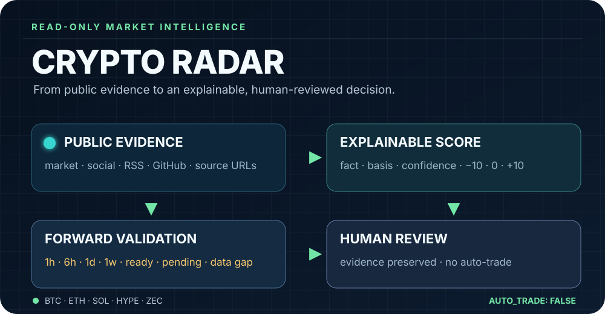
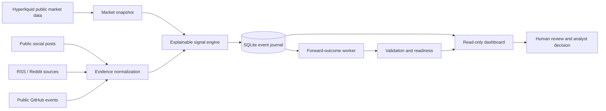

<p align="center">
  <strong>CRYPTO RADAR</strong>
</p>

<p align="center">
  Read-only crypto market intelligence for explainable signals, evidence, and forward validation.
</p>

<p align="center">
  <code>BTC</code> · <code>ETH</code> · <code>SOL</code> · <code>HYPE</code> · <code>ZEC</code>
</p>

<p align="center">
  <a href="#safety-boundary">Read-only by design</a> ·
  <a href="#quick-start">Quick start</a> ·
  <a href="#dashboard">Dashboard</a> ·
  <a href="#verification">Verification</a>
</p>

---

Crypto Radar turns public market, news, social, RSS, and GitHub signals into a local, inspectable research stream.

It is deliberately **not a trading bot**. The system collects evidence, assigns explainable signal grades, stores an append-only event history, materializes forward outcomes, and leaves final decisions to a human analyst.

<p align="center">
  
</p>

## What the project answers

- What changed in the market snapshot?
- Which assets and signal drivers explain the change?
- What evidence supports the signal, and how confident is it?
- Is the evidence fresh, independent, and still awaiting review?
- What happened after a signal at `1h`, `6h`, `1d`, or `1w`?
- Is the validation worker healthy, stale, pending, or failing?

## The operating model



### Signal contract

Every emitted signal is designed to be inspectable rather than opaque:

| Field | Meaning |
| --- | --- |
| `severity` | `low`, `medium`, or `high` operational grade |
| `fact` | What was observed |
| `basis` | Why the signal received its grade |
| `confidence` | Preliminary confidence, not truth probability |
| `source_urls` | Evidence links preserved with the signal |
| `possible_explanations` | Alternative interpretations |
| `requires_manual_review` | Explicit human-in-the-loop boundary |
| `auto_trade` | Always `false` |

News ranking uses a signed `-10…+10` score: positive, neutral `0`, or negative. Missing data is kept distinct from a measured zero.

## Safety boundary

Crypto Radar does **not**:

- place orders;
- sign transactions;
- call wallet, order, or withdrawal APIs;
- store wallet keys;
- publish or modify social content;
- treat social engagement as independent evidence;
- silently turn missing forward candles into a negative outcome.

Market and public-source ingestion is read-only. The dashboard may store an analyst's explicit review decision separately from the immutable market/event inputs.

## Quick start

Requirements:

- Python `3.11+`;
- Node.js and npm for the dashboard;
- a project-local Python environment.

```bash
git clone <repository-url>
cd crypto-radar

python3.11 -m venv .venv
.venv/bin/python -m pip install -e '.[test]'
cd web && npm install && cd ..
```

Run a live, read-only market snapshot:

```bash
PYTHONPATH=src .venv/bin/python -m crypto_radar.cli snapshot \
  --assets BTC,ETH,SOL,HYPE,ZEC
```

Check the public provider's currently available assets:

```bash
PYTHONPATH=src .venv/bin/python -m crypto_radar.cli assets \
  --assets HYPE,ZEC \
  --strict-assets
```

The strict form exits non-zero when the provider does not return a requested ticker; it does not fabricate unavailable assets.

## Dashboard

The dashboard is a React/Vite single-page app served by the read-only FastAPI application.

Start a production-like local instance:

```bash
./scripts/run_dashboard.sh
```

Open <http://127.0.0.1:8000>.

The dashboard provides:

- strategic overview and asset verdicts;
- structured signal drivers and evidence basis;
- asset metrics, candles, levels, and indicator history;
- event history and analyst review queue;
- news scores and dataset readiness;
- forward validation by horizon and dimension;
- GitHub Watch status;
- worker health with explicit `ok`, `pending`, `stale`, and `error` states.

The dashboard does not expose X OAuth, wallet, signing, order, or withdrawal functionality.

### API surface

The FastAPI app is mounted under `/api/v1`:

```text
GET  /health
GET  /overview
GET  /events
GET  /reviews
GET  /reviews/summary
GET  /reviews/validation
GET  /reviews/validation/time-split
GET  /reviews/validation/depth
GET  /reviews/validation/policy
PUT  /reviews/{event_id}
GET  /assets/{asset}
GET  /assets/{asset}/history
GET  /assets/{asset}/candles
GET  /assets/{asset}/indicator-history
GET  /assets/{asset}/indicators
GET  /assets/{asset}/levels
GET  /assets/{asset}/news
GET  /assets/{asset}/news/dataset
GET  /github/watch
POST /github/watch/poll
```

`PUT /reviews/{event_id}` records an explicit analyst decision; it does not mutate the source market event.

`GET /reviews/validation/time-split` is a read-only chronological 80/20 exploratory report over the collected events. It reports separate train/test `1h` metrics, keeps pending outcomes visible, and exposes a dataset gate (`100` ready samples and `80%` coverage) without changing production weights or enabling execution.

## Pipelines and scheduled workers

All recurring operations have a project-local launcher and emit structured output.

### Market candles and indicators

```bash
HISTORY=data/crypto_radar.sqlite3 \
ASSETS=BTC,ETH,SOL,HYPE,ZEC \
TIMEFRAMES=1m,10m,1h,6h,1d,1w \
FETCH_LIMIT=80 \
./scripts/run_indicators_pipeline.sh
```

The collector is idempotent by `asset + timeframe + candle_open_time`. It fetches source candles for `1m`, `1h`, and `1d`, then deterministically aggregates `10m`, `6h`, and `1w` while preserving OHLCV semantics.

For the complete scheduled market cycle, use the launcher below. It first persists closed candles and indicator observations, then emits the current composite events with normal alert deduplication and atomically writes the JSONL delivery file:

```bash
HISTORY=data/crypto_radar.sqlite3 \
ASSETS=BTC,ETH,SOL,HYPE,ZEC \
TIMEFRAMES=1m,10m,1h,6h,1d,1w \
FETCH_LIMIT=80 \
OUTCOME_LIMIT=500 \
JSONL_OUTPUT=data/alerts.jsonl \
./scripts/run_market_cycle.sh
```

The launcher runs the bounded outcome materializer after snapshot generation and records its durable worker state. It uses the project-local `.venv`, does not require Docker, and keeps intermediate reports in unique temporary files that are removed on exit. Use `./scripts/run_market_cycle.sh --help` for a non-destructive usage summary; unknown options fail before any provider call. Repeated identical cycles are suppressed by the existing stable alert fingerprint; no order, wallet, signing, or withdrawal API is involved.

### Forward outcomes

```bash
HISTORY=data/crypto_radar.sqlite3 \
LIMIT=500 \
./scripts/run_outcome_worker.sh
```

The worker persists ready and pending outcomes idempotently and emits counts for `attempted`, `ready`, `pending`, and `errors`.

Watch worker freshness:

```bash
HISTORY=data/crypto_radar.sqlite3 \
./scripts/watch_outcome_worker.py
```

Empty stdout means healthy. JSON output means an operational alert. A worker is stale after 15 minutes. UI priority is `error > stale > ok`.

### Social pipeline

Offline replay does not contact X:

```bash
HISTORY=data/crypto_radar.sqlite3 \
./scripts/run_social_pipeline.sh offline
```

Live mode requires manual `xurl` OAuth outside the agent session:

```bash
HISTORY=data/crypto_radar.sqlite3 \
QUERY='(HYPE OR ZEC) lang:en -is:retweet' \
./scripts/run_social_pipeline.sh live
```

The launcher refuses to run without usable credentials and does not read or print `~/.xurl`.

For direct CLI usage:

```bash
PYTHONPATH=src .venv/bin/python -m crypto_radar.cli social-search \
  --query '(HYPE OR ZEC) lang:en -is:retweet' \
  --limit 20 \
  --format json
```

Stored posts can be replayed and analyzed without another social API request:

```bash
PYTHONPATH=src .venv/bin/python -m crypto_radar.cli social-analyze \
  --history data/crypto_radar.sqlite3 \
  --query HYPE \
  --aggregate \
  --as-signals \
  --record-events
```

The analyzer deduplicates by post ID, counts independent authors rather than repost volume, preserves evidence URLs, applies freshness decay, and keeps `requires_manual_review=true`.

### RSS / Reddit pipeline

```bash
./scripts/run_rss_pipeline.sh
```

Use `--reddit-only` or a custom YAML source registry when a narrower source set is required.

### GitHub Watch

The Hermes Cron wrapper and production-like dashboard use the following five-repository baseline by default, including the Hyperliquid SDK repository for HYPE ecosystem signals. Override it with `GITHUB_WATCH_REPOS` when needed:

```bash
export GITHUB_WATCH_REPOS=bitcoin/bitcoin,ethereum/go-ethereum,anza-xyz/agave,hyperliquid-dex/hyperliquid-python-sdk,ZcashFoundation/zebra
# Optional: only for GitHub REST API rate limits.
# export GITHUB_TOKEN=...
```

Run a poll manually against an explicit history database (use a temporary path for a dry run):

```bash
PYTHONPATH=src .venv/bin/python scripts/watch_github.py \
  --repos bitcoin/bitcoin,ethereum/go-ethereum,anza-xyz/agave,hyperliquid-dex/hyperliquid-python-sdk,ZcashFoundation/zebra \
  --history /tmp/crypto-radar-github.sqlite3
```

The watcher stores deduplicated public release, fork, star, push, and issue/PR changes. The installed Hermes wrapper supplies the five-repository baseline and writes to the production SQLite history; direct CLI invocations without `--repos` or `GITHUB_WATCH_REPOS` perform no network request and exit successfully. The GitHub Cron job runs daily at 09:00 with local-only delivery.

## Data and validation semantics

The local SQLite history is the system of record for collected observations and event history.

### Forward status

The API keeps machine-readable statuses:

| Status | Analyst meaning |
| --- | --- |
| `ready` | Outcome is available |
| `pending` | The horizon has not matured yet |
| `data_gap` | Required forward data is unavailable |

The UI intentionally renders these separately as **готово**, **ожидается**, and **нет данных для горизонта**. A missing outcome is never treated as a zero return.

### News dataset

News records retain:

- production model and signed production score;
- shadow model metadata;
- raw feature vector;
- label state;
- per-horizon forward outcomes;
- readiness counts and coverage;
- training preparation status.

Training is read-only and is not started automatically. The current production model remains `rules-v1`; shadow metadata is visible for comparison.

### Source reputation

Source reputation is explicit and human-reviewed:

```bash
PYTHONPATH=src .venv/bin/python -m crypto_radar.cli source-reputation \
  --history data/crypto_radar.sqlite3 \
  --author project

PYTHONPATH=src .venv/bin/python -m crypto_radar.cli source-reputation \
  --history data/crypto_radar.sqlite3 \
  --author project \
  --record-outcome confirmed
```

Allowed outcomes are `confirmed`, `refuted`, and `uncertain`. Normal analysis reads reputation but never updates it automatically.

## JSONL export

Export only composite alerts emitted by the current run:

```bash
PYTHONPATH=src .venv/bin/python -m crypto_radar.cli snapshot \
  --assets BTC,ETH,SOL,HYPE,ZEC \
  --jsonl-output data/alerts.jsonl
```

The file is atomically replaced. It is empty when deduplication suppresses every alert. Each emitted line contains a complete signal with a stable `signal_id`, UTC `observed_at`, basis, severity, sources, and `auto_trade: false`.

## Hermes Cron readiness

The launchers are designed to run from the project directory as Hermes Cron jobs:

| Job | Suggested cadence | Purpose |
| --- | ---: | --- |
| `crypto-radar-market-cycle` | every 10 minutes | collect closed candles, indicators, composite events, JSONL, and materialize outcomes |
| `crypto-radar-outcome-watchdog` | every 5 minutes | alert on stale/error worker state |
| `crypto-radar-market-cycle-watchdog` | every 5 minutes | alert when no composite event was recorded recently |
| `crypto-radar-github-watch` | daily at 09:00 | poll the configured five-repository public baseline; delivery is local |

No live X cron job is created until manual `xurl auth status` confirms usable credentials. Offline replay remains available without OAuth.

## Verification

Use the project-local environment as the canonical Python runner:

```bash
.venv/bin/pytest -q --strict-config --strict-markers
cd web
npm ci
npm test -- --run
npm run build
npm run verify:assets
npm run test:e2e
```

`npm run test:e2e` runs Playwright against the production-like dashboard. The Playwright config starts `../scripts/run_dashboard.sh` when needed, waits for `/api/v1/health`, and reuses an existing listener on `127.0.0.1:8000`. The E2E matrix includes desktop Chromium route/active-navigation and enabled GitHub baseline checks, plus mobile Chromium (`390x844`) menu, GitHub baseline, and asset-detail checks.

The same commands are available in `.github/workflows/verification.yml` for every push, pull request, or manual `workflow_dispatch`; CI installs Chromium explicitly before the Playwright job, runs the canonical `npm run verify:assets` check to ensure the built HTML/CSS asset namespace is self-contained, cancels stale runs on the same ref, uploads Playwright traces/test results for seven days when verification fails, and stores a machine-readable `npm-audit.json` artifact for seven days on every run. The audit remains informational while functional verification stays mandatory. A temporary isolated test of the audit-suggested `react-router-dom@7.11.0` downgrade passed the frontend unit/build/E2E checks but still reported `2 high` vulnerabilities, so no downgrade was applied to the working lockfile. Dependabot monitors `/web` weekly via `.github/dependabot.yml`, opening at most five labeled dependency/security update PRs. Functional verification remains required for every proposed update.

Security reporting and dependency-advisory handling are documented in [`SECURITY.md`](SECURITY.md). Pull requests use the verification and security checklist in [`.github/pull_request_template.md`](.github/pull_request_template.md).

```text
crypto-radar/
├── src/crypto_radar/       # CLI, collectors, signal engine, persistence, FastAPI app
├── web/                    # React/Vite analyst dashboard
│   └── scripts/             # production artifact verification helpers
├── scripts/                # cron-ready pipeline and watchdog launchers
├── config/                 # source and application configuration
├── .github/                # CI, Dependabot, and pull-request governance
├── .gitignore              # local, build, runtime, and CI-generated exclusions
├── SECURITY.md             # vulnerability reporting and advisory policy
├── VERIFICATION_HANDOFF.md # verified PR handoff and known blockers
├── data/                   # local SQLite history and generated runtime files
├── tests/                  # backend and integration tests
├── pyproject.toml
└── README.md
```

## License

No license file is currently included in this repository. Add an explicit license before distributing the project.

## Status

Crypto Radar is a read-only research and validation system. It is intended for inspection, replay, and human-reviewed analysis—not financial advice and not automated trading.
